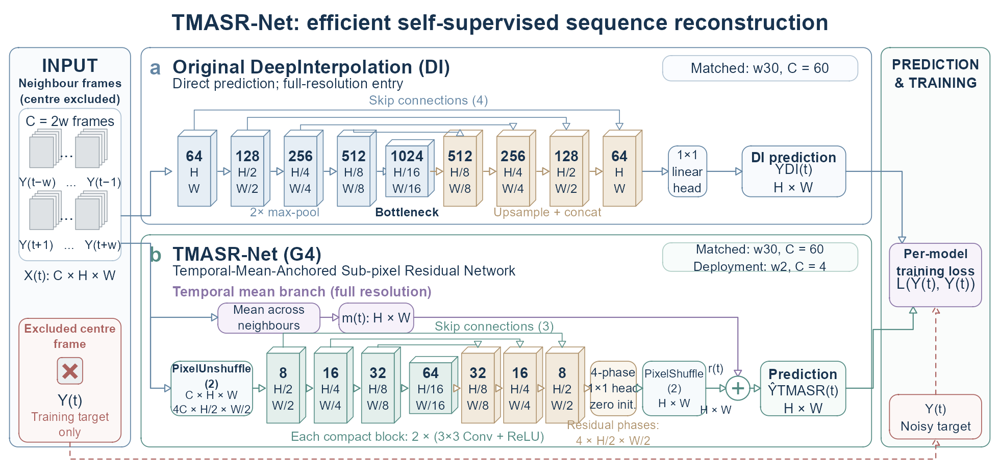

# Final completed experiment results

G4 combines a full-resolution temporal-mean anchor, a compact phase-domain residual U-Net and a zero-initialized output head. The primary contribution is retention of measured reconstruction PSNR with far less computation than the original DeepInterpolation architecture.

This page shares 124 experiment entries and 16,645 scalar endpoint rows. The capacity collection contains 405 trained runs and 135 deterministic baseline evaluations; the formal attribution study contains 252 trained runs plus nine temporal means. Normally completed controls are included whether their numerical result improves the baseline or not.

- [Experiment names, changes and purposes](experiments.csv)
- [Complete final scalar results](results.csv)
- [Architecture explanation](figure/architecture_comparison.png)

## Core matched comparison

At w30 (60 excluded-centre context frames), G4 has **139,204** parameters versus **15,704,769** for the original-architecture DI reproduction: **112.8x fewer parameters**. Convolution-only arithmetic is **80.4--83.9x lower**. RTX 5070 Ti batch-1 isolated forward measurements give **3.7--4.2x speedup** (FP16, channels-last, warmup20, repeats100; ratio of three-seed mean median times).

| Recording | DI MAE | DI MSE | G4 MSE | G4 minus MSE-DI |
|---|---:|---:|---:|---:|
| 01.00 | 15.4435 | 15.8617 | 15.8586 | -0.0031 |
| 01.01 | 28.5024 | 28.7237 | 28.7149 | -0.0089 |
| 03.00 | 13.2788 | 13.3705 | 13.3642 | -0.0063 |

Values are seed-0 validation PSNR (dB), after 75 epochs and objective-specific validation selection. The MAE-DI/G4 three-seed results and extra completed MSE-DI seed are separately labelled in the CSV. The objective-controlled G1--G5 study finds +0.2450/+0.2435 dB for MSE versus MAE and -0.0020/-0.0036 dB for half-grid versus full-grid placement. Its averaged G4 convolution cost is 1.464 GFLOPs versus G2's 5.334 GFLOPs.

## Reading the result table

`experiment_id` joins the two CSVs. Each scalar retains its recording, window/input offsets, seed, split, aggregation, measurement conditions, metric name, value and unit. Blank fields mean unmeasured or inapplicable. `single run` rows remain separate from `mean across N completed seeds` and `sample SD across N completed seeds`. The category tables below average completed seeds for display; the complete per-seed values remain in the CSV. Deterministic temporal baselines repeat evaluation labels, rather than independent random training.

PSNR uses each noisy target frame's range; clean PSNR is a separate synthetic diagnostic endpoint. Historical gSSIM and standard local SSIM are distinct. Frozen evaluation segments were previously inspected. `model forward`, `sequence processing` and `GPU-resident sequence compute` are separate timing scopes. Device and warmup details are supplied per row; a missing recorded GPU name is not inferred. The 4060 Laptop measurements are not reassigned to the 5070 Ti. Conv3d arithmetic includes the temporal kernel; the adapted DeepCAD-RT arm reports 254.611 GFLOPs at 512x512 and 242.800 GFLOPs at 498x490. Acquisition waiting is excluded from process timing.

Additional-recording validation trains on 02.00/04.00; it is not zero-shot transfer. Suite2p counts detected ROIs, and trace variability uses each condition's detected set. The mean anchor, clean image error, amplitude response, noise-floor estimates and ROI counts are different endpoints.

## Capacity and block study

| Experiment | What changed | Why measured | Final endpoints |
|---|---|---|---|
| bf16_d3_standard | Base width 16, depth 3, standard blocks | Measure width, depth and block quality-cost trade-offs on matched evaluation frames | mean_psnr_db (dB; evaluation): 01.00/w1=15.42; 01.00/w2=15.42; 01.00/w4=15.44; 01.01/w1=27.92; 01.01/w2=27.95; 01.01/w4=27.97; 03.00/w1=13.24; 03.00/w2=13.26; 03.00/w4=13.26 |
| bf4_d2_standard | Base width 4, depth 2, standard blocks | Measure width, depth and block quality-cost trade-offs on matched evaluation frames | mean_psnr_db (dB; evaluation): 01.00/w1=15.37; 01.00/w2=15.26; 01.00/w4=15.41; 01.01/w1=27.65; 01.01/w2=27.91; 01.01/w4=27.95; 03.00/w1=13.13; 03.00/w2=13.18; 03.00/w4=13.22 |
| bf4_d3_standard | Base width 4, depth 3, standard blocks | Measure width, depth and block quality-cost trade-offs on matched evaluation frames | mean_psnr_db (dB; evaluation): 01.00/w1=15.39; 01.00/w2=15.26; 01.00/w4=15.42; 01.01/w1=27.89; 01.01/w2=27.93; 01.01/w4=27.96; 03.00/w1=13.16; 03.00/w2=13.2; 03.00/w4=13.22 |
| bf8_d2_standard | Base width 8, depth 2, standard blocks | Measure width, depth and block quality-cost trade-offs on matched evaluation frames | mean_psnr_db (dB; evaluation): 01.00/w1=15.37; 01.00/w2=15.41; 01.00/w4=15.43; 01.01/w1=27.87; 01.01/w2=27.93; 01.01/w4=27.96; 03.00/w1=13.15; 03.00/w2=13.19; 03.00/w4=13.22 |
| bf8_d3_depthwise | Base width 8, depth 3, depthwise blocks | Measure width, depth and block quality-cost trade-offs on matched evaluation frames | mean_psnr_db (dB; evaluation): 01.00/w1=15.4; 01.00/w2=15.41; 01.00/w4=15.43; 01.01/w1=27.87; 01.01/w2=27.92; 01.01/w4=27.95; 03.00/w1=13.16; 03.00/w2=13.19; 03.00/w4=13.22 |
| bf8_d3_ghost | Base width 8, depth 3, ghost blocks | Measure width, depth and block quality-cost trade-offs on matched evaluation frames | mean_psnr_db (dB; evaluation): 01.00/w1=15.38; 01.00/w2=15.41; 01.00/w4=15.41; 01.01/w1=27.85; 01.01/w2=27.91; 01.01/w4=27.91; 03.00/w1=13.12; 03.00/w2=13.18; 03.00/w4=13.2 |
| bf8_d3_inverted_residual | Base width 8, depth 3, inverted residual blocks | Measure width, depth and block quality-cost trade-offs on matched evaluation frames | mean_psnr_db (dB; evaluation): 01.00/w1=15.4; 01.00/w2=15.42; 01.00/w4=15.42; 01.01/w1=27.89; 01.01/w2=27.94; 01.01/w4=27.96; 03.00/w1=13.18; 03.00/w2=13.23; 03.00/w4=13.23 |
| bf8_d3_standard_full_reference | Base width 8, depth 3, standard blocks | Measure width, depth and block quality-cost trade-offs on matched evaluation frames | mean_psnr_db (dB; evaluation): 01.00/w1=15.4; 01.00/w2=15.42; 01.00/w4=15.43; 01.01/w1=27.91; 01.01/w2=27.95; 01.01/w4=27.97; 03.00/w1=13.22; 03.00/w2=13.23; 03.00/w4=13.24 |
| bf8_d4_standard | Base width 8, depth 4, standard blocks | Measure width, depth and block quality-cost trade-offs on matched evaluation frames | mean_psnr_db (dB; evaluation): 01.00/w1=15.42; 01.00/w2=15.43; 01.00/w4=15.43; 01.01/w1=27.92; 01.01/w2=27.96; 01.01/w4=27.97; 03.00/w1=13.25; 03.00/w2=13.25; 03.00/w4=13.25 |
| previous_frame_or_nearest_window | Deterministic previous frame or nearest window prediction | Measure width, depth and block quality-cost trade-offs on matched evaluation frames | mean_psnr_db (dB; evaluation): 01.00/w1=12.89; 01.00/w2=12.89; 01.00/w4=12.86; 01.01/w1=25.24; 01.01/w2=25.23; 01.01/w4=25.21; 03.00/w1=10.39; 03.00/w2=10.37; 03.00/w4=10.35 |
| temporal_mean | Deterministic temporal mean prediction | Measure width, depth and block quality-cost trade-offs on matched evaluation frames | mean_psnr_db (dB; evaluation): 01.00/w1=14.13; 01.00/w2=14.93; 01.00/w4=15.38; 01.01/w1=26.49; 01.01/w2=27.28; 01.01/w4=27.73; 03.00/w1=11.64; 03.00/w2=12.43; 03.00/w4=12.87 |
| temporal_median | Deterministic temporal median prediction | Measure width, depth and block quality-cost trade-offs on matched evaluation frames | mean_psnr_db (dB; evaluation): 01.00/w1=13.98; 01.00/w2=14.44; 01.00/w4=14.82; 01.01/w1=25.97; 01.01/w2=26.74; 01.01/w4=27.29; 03.00/w1=10.75; 03.00/w2=11.68; 03.00/w4=12.36 |

## Past-only inputs

| Experiment | What changed | Why measured | Final endpoints |
|---|---|---|---|
| Past-only G4 | Use only offsets -2 and -1; two input frames | Measure reconstruction with no future-frame waiting | mean_psnr_db (dB; val): 01.00/w2_causal=15.85; 01.01/w2_causal=28.68; 03.00/w2_causal=13.31 |

## Context on demand screen

| Experiment | What changed | Why measured | Final endpoints |
|---|---|---|---|
| context_diff_init_w4_psnr_aligned_b8d3 | same inference graph as subpixel_residual_b8d3 at w4; initialisation change only | outer-difference initialisation | mean_psnr_db (dB; val): 01.00/w4=15.86; 01.01/w4=28.71; 03.00/w4=13.3 |

## Deepcad rt baseline

| Experiment | What changed | Why measured | Final endpoints |
|---|---|---|---|
| Adapted DeepCAD-RT architecture | Conv3d U-Net 16/32/64/128; spatial-only pooling; temporal-mean output head | Compare a 3D architecture under the local centre-excluded MSE protocol | mean_psnr_db (dB; val): 01.00/w2=15.86; 01.01/w2=28.68; 03.00/w2=13.35 |

## Fundamental confirmation

| Experiment | What changed | Why measured | Final endpoints |
|---|---|---|---|
| subpixel_psnr_aligned_b8d3 | same inference graph as subpixel_residual_b8d3 | PSNR without inference overhead | mean_psnr_db (dB; val): 01.00/w2=15.86; 01.00/w4=15.86; 01.01/w2=28.7; 01.01/w4=28.72; 03.00/w2=13.33; 03.00/w4=13.32 |

## Fundamental screen

| Experiment | What changed | Why measured | Final endpoints |
|---|---|---|---|
| subpixel_frame_log_mse_b8d3 | same inference graph as subpixel_residual_b8d3; objective and selection change only | endpoint-aligned frame aggregation | mean_psnr_db (dB; val): 01.00/w2=15.86; 01.01/w2=28.69; 03.00/w2=13.32 |
| subpixel_odd_shift_psnr_aligned_b8d3 | same inference graph as subpixel_residual_b8d3; training-time augmentation only | phase-symmetrised training data | mean_psnr_db (dB; val): 01.00/w2=15.86; 01.01/w2=28.68; 03.00/w2=13.3 |
| subpixel_psnr_aligned_b8d3 | same inference graph as subpixel_residual_b8d3 | PSNR without inference overhead | mean_psnr_db (dB; val): 01.00/w2=15.86; 01.00/w4=15.86; 01.01/w2=28.69; 01.01/w4=28.71; 03.00/w2=13.32; 03.00/w4=13.3 |
| subpixel_psnr_selection_b8d3 | same inference graph as subpixel_residual_b8d3; selection change only | endpoint-aligned checkpoint selection | mean_psnr_db (dB; val): 01.00/w2=15.86; 01.01/w2=28.69; 03.00/w2=13.32 |

## G4w30 confirmation

| Experiment | What changed | Why measured | Final endpoints |
|---|---|---|---|
| subpixel_psnr_aligned_b8d3 | same inference graph as subpixel_residual_b8d3 | PSNR without inference overhead | mean_psnr_db (dB; val): 01.00/w30=15.86; 01.01/w30=28.71; 03.00/w30=13.36 |

## Innovation screen

| Experiment | What changed | Why measured | Final endpoints |
|---|---|---|---|
| baseline_b8d3 | standard full-resolution U-Net | reference | mean_psnr_db (dB; test): 01.00/w2=15.42 |
| subpixel_distilled_b8d3 | same inference graph as subpixel_residual_b8d3 | PSNR with unchanged inference graph | mean_psnr_db (dB; test): 01.00/w2=15.45 |
| subpixel_group_shift_b8d3 | 2 x pixel unshuffle with grouped low-resolution spatiotemporal shift | PSNR at retained convolution cost | mean_psnr_db (dB; test): 01.00/w2=15.45 |
| subpixel_highpass_gate_b8d3 | 2 x pixel unshuffle plus gated zero-mean high-pass correction | MAE and PSNR | mean_psnr_db (dB; test): 01.00/w2=15.41 |
| subpixel_naf_lite_b8d3 | 2 x pixel unshuffle with one deepest-scale NAF block | PSNR at retained runtime | mean_psnr_db (dB; test): 01.00/w2=15.48 |
| subpixel_partial_naf_half_b8d3 | 2 x pixel unshuffle with half-channel deepest-scale NAF | PSNR at reduced NAF latency | mean_psnr_db (dB; test): 01.00/w2=15.48 |
| subpixel_partial_naf_quarter_b8d3 | 2 x pixel unshuffle with quarter-channel deepest-scale NAF | PSNR at reduced NAF latency | mean_psnr_db (dB; test): 01.00/w2=15.46 |
| subpixel_residual_b8d3 | 2 x pixel unshuffle, residual U-Net, pixel shuffle | runtime | mean_psnr_db (dB; test): 01.00/w2=15.45 |
| subpixel_symmetric_anchor_b8d3 | 2 x pixel unshuffle with distance-symmetric temporal anchor | PSNR with constrained temporal weighting | mean_psnr_db (dB; test): 01.00/w2=15.43 |

## Next generation screen

| Experiment | What changed | Why measured | Final endpoints |
|---|---|---|---|
| baseline_b8d3 | standard full-resolution U-Net | reference | mean_psnr_db (dB; val): 01.00/w2=15.39; 01.01/w2=28.46; 03.00/w2=13.23 |
| ctpf_subpixel_b8d3 | shared equidistant-pair stem, low-resolution distance gate and subpixel residual U-Net | temporally explicit reconstruction | mean_psnr_db (dB; val): 01.00/w2=15.42; 01.01/w2=28.47; 03.00/w2=13.23 |
| subpixel_dense_refiner_b8d3 | subpixel residual U-Net with one dense bottleneck residual block | PSNR with regular GPU kernels | mean_psnr_db (dB; val): 01.00/w2=15.39; 01.01/w2=28.47; 03.00/w2=13.24 |
| subpixel_naf_lite_b8d3 | 2 x pixel unshuffle with one deepest-scale NAF block | PSNR at retained runtime | mean_psnr_db (dB; val): 01.00/w2=15.43; 01.01/w2=28.47; 03.00/w2=13.23 |
| subpixel_projected_decoder_b8d3 | subpixel residual U-Net with projected-add decoder fusion | runtime at retained fidelity | mean_psnr_db (dB; val): 01.00/w2=15.39; 01.01/w2=28.44; 03.00/w2=13.21 |
| subpixel_psnr_aligned_b8d3 | same inference graph as subpixel_residual_b8d3 | PSNR without inference overhead | mean_psnr_db (dB; val): 01.00/w2=15.86; 01.01/w2=28.69; 03.00/w2=13.32 |
| subpixel_residual_b8d3 | 2 x pixel unshuffle, residual U-Net, pixel shuffle | runtime | mean_psnr_db (dB; val): 01.00/w2=15.39; 01.01/w2=28.47; 03.00/w2=13.23 |

## Objective controlled structure screen

| Experiment | What changed | Why measured | Final endpoints |
|---|---|---|---|
| baseline_psnr_aligned_b8d3 | standard full-resolution U-Net | PSNR-aligned full-resolution reference | mean_psnr_db (dB; val): 01.00/w2=15.85; 01.01/w2=28.67; 03.00/w2=13.33 |
| ctpf_psnr_aligned_b8d3 | same inference graph as ctpf_subpixel_b8d3 | temporally explicit PSNR | mean_psnr_db (dB; val): 01.00/w2=15.86; 01.01/w2=28.69; 03.00/w2=13.32 |
| subpixel_dense_refiner_psnr_aligned_b8d3 | same inference graph as subpixel_dense_refiner_b8d3 | PSNR with regular GPU kernels | mean_psnr_db (dB; val): 01.00/w2=15.86; 01.01/w2=28.69; 03.00/w2=13.32 |
| subpixel_naf_lite_psnr_aligned_b8d3 | same inference graph as subpixel_naf_lite_b8d3 | quality-heavy PSNR | mean_psnr_db (dB; val): 01.00/w2=15.86; 01.01/w2=28.69; 03.00/w2=13.32 |
| subpixel_psnr_aligned_b8d3 | same inference graph as subpixel_residual_b8d3 | PSNR without inference overhead | mean_psnr_db (dB; val): 01.00/w2=15.86; 01.01/w2=28.69; 03.00/w2=13.32 |

## Original di mse

| Experiment | What changed | Why measured | Final endpoints |
|---|---|---|---|
| original_di_unet_mse | same inference graph as original_di_unet_mae; objective change only | objective confound control for the reproduction | mean_psnr_db (dB; val): 01.00/w30=15.86; 01.01/w30=28.72; 03.00/w30=13.37 |

## Original di reproduction

| Experiment | What changed | Why measured | Final endpoints |
|---|---|---|---|
| original_di_unet_mae | direct centre-frame output without anchor or residual path | original DeepInterpolation architecture reproduction | mean_psnr_db (dB; val): 01.00/w30=15.43; 01.01/w30=28.5; 03.00/w30=13.28 |

## G1--G5 and mechanism attribution

| Experiment | What changed | Why measured | Final endpoints |
|---|---|---|---|
| paper_fullres_b8d3_mae | full-resolution B8-D3 temporal-mean residual U-Net | factorial full-resolution MAE arm | mean_psnr_db (dB; evaluation (previously inspected)): 01.00/w1=15.41; 01.00/w2=15.43; 01.00/w4=15.43; 01.01/w1=27.91; 01.01/w2=27.95; 01.01/w4=27.97; 03.00/w1=13.22; 03.00/w2=13.24; 03.00/w4=13.25 |
| paper_fullres_b8d3_mse | same inference graph as paper_fullres_b8d3_mae | factorial full-resolution MSE arm | mean_psnr_db (dB; evaluation (previously inspected)): 01.00/w1=15.86; 01.00/w2=15.87; 01.00/w4=15.88; 01.01/w1=28.1; 01.01/w2=28.14; 01.01/w4=28.16; 03.00/w1=13.32; 03.00/w2=13.34; 03.00/w4=13.35 |
| paper_fullres_b8d4_mse | full-resolution B8-D4 temporal-mean residual U-Net | higher-capacity quality reference | mean_psnr_db (dB; evaluation (previously inspected)): 01.00/w1=15.87; 01.00/w2=15.88; 01.00/w4=15.88; 01.01/w1=28.12; 01.01/w2=28.15; 01.01/w4=28.17; 03.00/w1=13.34; 03.00/w2=13.35; 03.00/w4=13.35 |
| paper_subpixel_b8d3_mae | 2 x pixel unshuffle, B8-D3 residual U-Net and pixel shuffle | factorial subpixel MAE arm | mean_psnr_db (dB; evaluation (previously inspected)): 01.00/w1=15.42; 01.00/w2=15.43; 01.00/w4=15.43; 01.01/w1=27.9; 01.01/w2=27.94; 01.01/w4=27.96; 03.00/w1=13.22; 03.00/w2=13.24; 03.00/w4=13.24 |
| paper_subpixel_b8d3_mse | same inference graph as paper_subpixel_b8d3_mae | factorial subpixel MSE arm | mean_psnr_db (dB; evaluation (previously inspected)): 01.00/w1=15.87; 01.00/w2=15.88; 01.00/w4=15.88; 01.01/w1=28.1; 01.01/w2=28.14; 01.01/w4=28.16; 03.00/w1=13.31; 03.00/w2=13.33; 03.00/w4=13.33 |
| paper_ctpf_subpixel_b8d3_mse | same inference graph as ctpf_subpixel_b8d3 | explicit temporal pair fusion | mean_psnr_db (dB; evaluation (previously inspected)): 01.00/w1=15.87; 01.00/w2=15.87; 01.00/w4=15.88; 01.01/w1=28.1; 01.01/w2=28.14; 01.01/w4=28.16; 03.00/w1=13.31; 03.00/w2=13.33; 03.00/w4=13.33 |
| paper_subpixel_dense_b8d3_mse | same inference graph as subpixel_dense_refiner_b8d3 | regular low-resolution capacity | mean_psnr_db (dB; evaluation (previously inspected)): 01.00/w1=15.87; 01.00/w2=15.88; 01.00/w4=15.88; 01.01/w1=28.1; 01.01/w2=28.13; 01.01/w4=28.16; 03.00/w1=13.33; 03.00/w2=13.33; 03.00/w4=13.33 |
| paper_subpixel_naf_lite_b8d3_mse | same inference graph as subpixel_naf_lite_b8d3 | small-operator restoration capacity | mean_psnr_db (dB; evaluation (previously inspected)): 01.00/w1=15.87; 01.00/w2=15.88; 01.00/w4=15.88; 01.01/w1=28.1; 01.01/w2=28.14; 01.01/w4=28.16; 03.00/w1=13.32; 03.00/w2=13.33; 03.00/w4=13.33 |
| temporal_mean | Parameter-free centre-excluded temporal mean | Compare reconstruction to the mean anchor | mean_psnr_db (dB; test): 01.00/w1=14.13; 01.00/w2=14.93; 01.00/w4=15.38; 01.01/w1=26.49; 01.01/w2=27.28; 01.01/w4=27.73; 03.00/w1=11.64; 03.00/w2=12.43; 03.00/w4=12.87 |

## Quick screen

| Experiment | What changed | Why measured | Final endpoints |
|---|---|---|---|
| adaptive_anchor_b8d3 | 1 x 1 temporal gate plus baseline residual U-Net | PSNR | mean_psnr_db (dB; test): 01.00/w2=15.43 |
| baseline_b8d3 | standard full-resolution U-Net | reference | mean_psnr_db (dB; test): 01.00/w2=15.42 |
| consensus_attention_b8d3 | half-resolution temporal attention anchor plus baseline residual U-Net | PSNR and temporal selectivity | mean_psnr_db (dB; test): 01.00/w2=15.41 |
| lowres_heavy_residual | 6-12-24 encoder, 80-channel bottleneck, temporal-mean residual | runtime at retained fidelity | mean_psnr_db (dB; test): 01.00/w2=15.42 |
| mean_residual_b8d3 | baseline U-Net plus parameter-free temporal anchor | PSNR and convergence | mean_psnr_db (dB; test): 01.00/w2=15.42 |
| naf_bottleneck_residual | standard U-Net with two low-resolution NAF blocks | PSNR | mean_psnr_db (dB; test): 01.00/w2=15.46 |
| rep_residual_b8d3 | multi-branch training; fused standard convolution inference | PSNR without deployment overhead | mean_psnr_db (dB; test): 01.00/w2=15.42 |
| subpixel_residual_b8d3 | 2 x pixel unshuffle, residual U-Net, pixel shuffle | runtime | mean_psnr_db (dB; test): 01.00/w2=15.45 |

## Relative frontier screen

| Experiment | What changed | Why measured | Final endpoints |
|---|---|---|---|
| slimmable_psnr_aligned_b8d3 | G4 geometry with nested channel slices at widths 1.0/0.5/0.25 | single-model multi-operating-point frontier | mean_psnr_db (dB; val): 01.00/w2=15.54; 01.01/w2=28.62; 03.00/w2=13.19 |
| subpixel4_psnr_aligned_b8d3 | 4 x pixel unshuffle, B8-D3 residual U-Net and pixel shuffle | extreme computation relocation | mean_psnr_db (dB; val): 01.00/w2=15.57; 01.01/w2=28.37; 03.00/w2=12.93 |
| subpixel_psnr_aligned_b8d3 | same inference graph as subpixel_residual_b8d3 | PSNR without inference overhead | mean_psnr_db (dB; val): 01.00/w2=15.86; 01.01/w2=28.69; 03.00/w2=13.32 |

## Single seed confirmation

| Experiment | What changed | Why measured | Final endpoints |
|---|---|---|---|
| baseline_b8d3 | standard full-resolution U-Net | reference | mean_psnr_db (dB; test): 01.00/w1=15.42; 01.00/w2=15.43; 01.00/w4=15.43; 01.01/w1=27.9; 01.01/w2=27.95; 01.01/w4=27.96; 03.00/w1=13.22; 03.00/w2=13.24; 03.00/w4=13.25 |
| subpixel_naf_lite_b8d3 | 2 x pixel unshuffle with one deepest-scale NAF block | PSNR at retained runtime | mean_psnr_db (dB; test): 01.00/w1=15.42; 01.00/w2=15.44; 01.00/w4=15.44; 01.01/w1=27.9; 01.01/w2=27.94; 01.01/w4=27.96; 03.00/w1=13.22; 03.00/w2=13.25; 03.00/w4=13.25 |
| subpixel_partial_naf_half_b8d3 | 2 x pixel unshuffle with half-channel deepest-scale NAF | PSNR at reduced NAF latency | mean_psnr_db (dB; test): 01.00/w1=15.44; 01.00/w2=15.44; 01.00/w4=15.42; 01.01/w1=27.92; 01.01/w2=27.94; 01.01/w4=27.96; 03.00/w1=13.21; 03.00/w2=13.23; 03.00/w4=13.25 |
| subpixel_residual_b8d3 | 2 x pixel unshuffle, residual U-Net, pixel shuffle | runtime | mean_psnr_db (dB; test): 01.00/w1=15.41; 01.00/w2=15.43; 01.00/w4=15.42; 01.01/w1=27.91; 01.01/w2=27.94; 01.01/w4=27.95; 03.00/w1=13.22; 03.00/w2=13.24; 03.00/w4=13.24 |

## Subpixel4 width test

| Experiment | What changed | Why measured | Final endpoints |
|---|---|---|---|
| subpixel4_psnr_aligned_b8d3 | 4 x pixel unshuffle, B8-D3 residual U-Net and pixel shuffle | extreme computation relocation | mean_psnr_db (dB; val): 01.00/w2=15.37; 01.01/w2=28.16; 03.00/w2=12.73 |
| subpixel4_wide16_psnr_aligned_b8d3 | 4 x pixel unshuffle with features (16, 32, 64) | effective-width corollary test (F=16) | mean_psnr_db (dB; val): 01.00/w2=15.57; 01.01/w2=28.28; 03.00/w2=12.91 |
| subpixel4_wide32_psnr_aligned_b8d3 | 4 x pixel unshuffle with features (32, 64, 128) | effective-width corollary test (F=32) | mean_psnr_db (dB; val): 01.00/w2=15.74; 01.01/w2=28.51; 03.00/w2=13.14 |

## Targeted screen

| Experiment | What changed | Why measured | Final endpoints |
|---|---|---|---|
| baseline_b8d3 | standard full-resolution U-Net | reference | mean_psnr_db (dB; test): 01.00/w2=15.42 |
| subpixel_adaptive_anchor_b8d3 | 2 x pixel unshuffle with a 1 x 1 temporal anchor | PSNR at retained runtime | mean_psnr_db (dB; test): 01.00/w2=15.45 |
| subpixel_detail_fusion_b8d3 | 2 x pixel unshuffle plus one shallow full-resolution correction | MAE and PSNR at retained runtime | mean_psnr_db (dB; test): 01.00/w2=15.43 |
| subpixel_naf_lite_b8d3 | 2 x pixel unshuffle with one deepest-scale NAF block | PSNR at retained runtime | mean_psnr_db (dB; test): 01.00/w2=15.48 |
| subpixel_residual_b8d3 | 2 x pixel unshuffle, residual U-Net, pixel shuffle | runtime | mean_psnr_db (dB; test): 01.00/w2=15.45 |

## Additional-recording validation (retrained)

| Experiment | What changed | Why measured | Final endpoints |
|---|---|---|---|
| Additional-recording validation (retrained G4) | Fixed G4-w2 design trained separately on 02.00 and 04.00 | Evaluate the fixed design after training on additional recordings | mean_psnr_db (dB; val): 02.00/w2=26.63; 04.00/w2=34.66 |

## Attribution

| Experiment | What changed | Why measured | Final endpoints |
|---|---|---|---|
| paired_effects | Objective, placement, depth and mechanism paired differences | Separate the effect of the loss function from the computation location | capacity_reference mean_delta_psnr_db=0.01685; mechanism_ctpf mean_delta_psnr_db=0.002272; mechanism_dense mean_delta_psnr_db=0.006521; mechanism_naf_lite mean_delta_psnr_db=0.006112; objective_fullres mean_delta_psnr_db=0.245; objective_subpixel mean_delta_psnr_db=0.2435; structure_mae mean_delta_psnr_db=-0.002008; structure_mse mean_delta_psnr_db=-0.003552; structure_objective_interaction mean_delta_psnr_db=-0.001545 |

## Standard local SSIM

| Experiment | What changed | Why measured | Final endpoints |
|---|---|---|---|
| paper_fullres_b8d3_mse | 11x11 Gaussian local SSIM, sigma1.5, valid support | Measure standard local structural similarity separately from global gSSIM | standard_local_ssim (dimensionless; val): 01.00/w2=0.7005; 01.01/w2=0.971; 03.00/w2=0.6013 |
| paper_subpixel_b8d3_mse | 11x11 Gaussian local SSIM, sigma1.5, valid support | Measure standard local structural similarity separately from global gSSIM | standard_local_ssim (dimensionless; val): 01.00/w2=0.7012; 01.01/w2=0.9711; 03.00/w2=0.6008 |

## Complete sequence processing

| Experiment | What changed | Why measured | Final endpoints |
|---|---|---|---|
| g4 | Sequential TIFF-to-output processing | Measure full processing cost including I/O, preprocessing and transfers | total (ms/frame; sequence processing): 01.00/w2=9.813; 01.01/w2=8.264; 03.00/w2=8.735 |
| g2 | Sequential TIFF-to-output processing | Measure full processing cost including I/O, preprocessing and transfers | total (ms/frame; sequence processing): 01.00/w2=7.818; 01.01/w2=8.619; 03.00/w2=7.881 |

## Streaming forward

| Experiment | What changed | Why measured | Final endpoints |
|---|---|---|---|
| original_di | Context-dependent streaming model forward | Report the original w30 and deployment w2 operating points |  |
| g4_w2 | Context-dependent streaming model forward | Report the original w30 and deployment w2 operating points |  |

## Clean-reference simulation

| Experiment | What changed | Why measured | Final endpoints |
|---|---|---|---|
| g4 | 2x sub-pixel mean-anchored residual model | Measure clean-reference error and transient response under Poisson/Gaussian noise | clean_psnr (dB; diagnostic clean reference): synthetic300_peak16/w2=41.32; synthetic300_peak32/w2=43.12 |
| g2 | Full-resolution MSE compact control | Measure clean-reference error and transient response under Poisson/Gaussian noise | clean_psnr (dB; diagnostic clean reference): synthetic300_peak16/w2=43.5; synthetic300_peak32/w2=44.66 |
| g8 | 4x sub-pixel compact model | Measure clean-reference error and transient response under Poisson/Gaussian noise | clean_psnr (dB; diagnostic clean reference): synthetic300_peak16/w2=31.06; synthetic300_peak32/w2=33.28 |
| temporal_mean | Parameter-free four-neighbour mean | Measure clean-reference error and transient response under Poisson/Gaussian noise | clean_psnr (dB; diagnostic clean reference): synthetic300_peak16/w2=29.26; synthetic300_peak32/w2=31.49 |
| constrained | Shared spatial encoder with dynamic-constrained temporal estimator | Measure clean-reference error and transient response under Poisson/Gaussian noise | clean_psnr (dB; diagnostic clean reference): synthetic300_peak16/w2=34.65; synthetic300_peak32/w2=36.56 |
| learned | Same shared spatial backbone with learned 1x1 temporal fusion | Measure clean-reference error and transient response under Poisson/Gaussian noise | clean_psnr (dB; diagnostic clean reference): synthetic300_peak16/w2=41.91; synthetic300_peak32/w2=43.8 |

## Official ROI projection

| Experiment | What changed | Why measured | Final endpoints |
|---|---|---|---|
| g4_w2 | Official ROI trace projection | Measure trace variability and dynamic range | trace_noise_floor_reduction_median (dimensionless; val): 01.00/w2=4.199; 01.01/w2=7.929; 03.00/w2=10.08 |
| g2_w2 | Official ROI trace projection | Measure trace variability and dynamic range | trace_noise_floor_reduction_median (dimensionless; val): 01.00/w2=4.575; 01.01/w2=6.931; 03.00/w2=10.15 |
| original_di_w30 | Official ROI trace projection | Measure trace variability and dynamic range | trace_noise_floor_reduction_median (dimensionless; val): 01.00/w30=4.406; 01.01/w30=18.33; 03.00/w30=74.59 |
| temporal_mean_w2 | Official ROI trace projection | Measure trace variability and dynamic range | trace_noise_floor_reduction_median (dimensionless; val): 01.00/w2=5.266; 01.01/w2=5.054; 03.00/w2=6.234 |
| temporal_mean_w30 | Official ROI trace projection | Measure trace variability and dynamic range | trace_noise_floor_reduction_median (dimensionless; val): 01.00/w2=514.6; 01.01/w2=347.3; 03.00/w2=761.2 |

## Estimated noise-floor measurements

| Experiment | What changed | Why measured | Final endpoints |
|---|---|---|---|
| g4_w2 | Temporal-variogram noise-floor estimate | Compare estimated input and output variability | floor_reduction_ratio (dimensionless; val): 01.00/w2=167.1; 01.01/w2=169.9; 03.00/w2=163.9 |
| g2_w2 | Temporal-variogram noise-floor estimate | Compare estimated input and output variability | floor_reduction_ratio (dimensionless; val): 01.00/w2=169.6; 01.01/w2=141.9; 03.00/w2=134.9 |
| original_di_w30 | Temporal-variogram noise-floor estimate | Compare estimated input and output variability | floor_reduction_ratio (dimensionless; val): 01.00/w30=188.4; 01.01/w30=409.6; 03.00/w30=214.1 |
| g4_w30 | Temporal-variogram noise-floor estimate | Compare estimated input and output variability | floor_reduction_ratio (dimensionless; val): 01.00/w2=224.6; 01.01/w2=479.8; 03.00/w2=280.3 |
| temporal_mean_w2 | Temporal-variogram noise-floor estimate | Compare estimated input and output variability | floor_reduction_ratio (dimensionless; val): 01.00/w2=6.378; 01.01/w2=6.345; 03.00/w2=6.352 |
| temporal_mean_w30 | Temporal-variogram noise-floor estimate | Compare estimated input and output variability | floor_reduction_ratio (dimensionless; val): 01.00/w2=1001; 01.01/w2=915.3; 03.00/w2=959.3 |

## Suite2p utility

| Experiment | What changed | Why measured | Final endpoints |
|---|---|---|---|
| raw | Raw movie | Measure detected ROI count and median relative trace noise | roi_count (count; full recording utility): 01.00=245; 01.01=434; 03.00=412 |
| g4_denoised | G4-w2 processed movie | Measure detected ROI count and median relative trace noise | roi_count (count; full recording utility): 01.00/w2=437; 01.01/w2=816; 03.00/w2=1176 |

## Shared encoder cost

| Experiment | What changed | Why measured | Final endpoints |
|---|---|---|---|
| g4 | Independent frame encoding; g4 | Measure feature reuse cost before committing to real-recording training |  |
| learned | Independent frame encoding; learned | Measure feature reuse cost before committing to real-recording training |  |
| constrained_uncached | Independent frame encoding; constrained_uncached | Measure feature reuse cost before committing to real-recording training |  |
| constrained_cached | Independent frame encoding; constrained_cached | Measure feature reuse cost before committing to real-recording training |  |

## Context cost

| Experiment | What changed | Why measured | Final endpoints |
|---|---|---|---|
| g4_w2 | g4 w2 | Measure pooled context-bypass inference cost | p50_ms (ms/frame; model forward): measured=0.6912 |
| g4_w4 | g4 w4 | Measure pooled context-bypass inference cost | p50_ms (ms/frame; model forward): w4=0.7199 |
| core_only | core only | Measure pooled context-bypass inference cost | p50_ms (ms/frame; model forward): measured=0.6779 |
| outer_linear | outer linear | Measure pooled context-bypass inference cost | p50_ms (ms/frame; model forward): measured=0.908 |
| outer_capacity | outer capacity | Measure pooled context-bypass inference cost | p50_ms (ms/frame; model forward): measured=0.9479 |
| nearest_capacity | nearest capacity | Measure pooled context-bypass inference cost | p50_ms (ms/frame; model forward): measured=0.8859 |
| diff_init_w4 | diff init w4 | Measure pooled context-bypass inference cost | p50_ms (ms/frame; model forward): w4=0.7331 |

## Window cost

| Experiment | What changed | Why measured | Final endpoints |
|---|---|---|---|
| g4_w2 | g4 w2 | Measure wider-context arithmetic and latency | p50_ms (ms/frame; model forward): measured=0.6581 |
| g4_w4 | g4 w4 | Measure wider-context arithmetic and latency | p50_ms (ms/frame; model forward): w4=0.6995 |
| g4_w4_498 | g4 w4 498 | Measure wider-context arithmetic and latency | p50_ms (ms/frame; model forward): w4=0.6632 |

## Shared width sweep

| Experiment | What changed | Why measured | Final endpoints |
|---|---|---|---|
| slimmable_1.0 | Select channel fraction 1.0 from one trained model | Measure shared-weight width operating points | mean_psnr_db (dB; val): 01.00/w2=15.84; 01.01/w2=28.64; 03.00/w2=13.29 |
| slimmable_0.5 | Select channel fraction 0.5 from one trained model | Measure shared-weight width operating points | mean_psnr_db (dB; val): 01.00/w2=15.72; 01.01/w2=28.55; 03.00/w2=13.11 |
| slimmable_0.25 | Select channel fraction 0.25 from one trained model | Measure shared-weight width operating points | mean_psnr_db (dB; val): 01.00/w2=15.65; 01.01/w2=28.44; 03.00/w2=12.98 |

## Relocation cost

| Experiment | What changed | Why measured | Final endpoints |
|---|---|---|---|
| g4 | 2x rearrangement | Measure whether the additional convolution reduction lowers forward time | p50_ms (ms/frame; model forward): (4, 512, 512)/w2=0.675; (4, 498, 490)/w2=0.6943 |
| subpixel4 | 4x rearrangement | Measure whether the additional convolution reduction lowers forward time | p50_ms (ms/frame; model forward): (4, 512, 512)/w2=0.6561; (4, 498, 490)/w2=0.6976 |

## Residual diagnostics

| Experiment | What changed | Why measured | Final endpoints |
|---|---|---|---|
| directionality | Fixed G4 reconstruction residual | Measure scan-line lag-1 autocovariances | 01.00 ratio=102.1; 01.01 ratio=42.38; 03.00 ratio=25.59 |
| row_decomposition | Fixed G4 reconstruction residual | Measure row-profile energies and association with neighbouring and target rows | 01.00 transfer_r2=0.001053; 01.00 transfer_r2=0.005637; 01.01 transfer_r2=0.0001373; 01.01 transfer_r2=0.0003769; 03.00 transfer_r2=0.0009376; 03.00 transfer_r2=0.0001525 |

## Architecture schematic and tools

Explanatory diagram generated and revised with OpenAI imagegen on 12 October 2026; the interface did not expose the image model version. Channels, dimensions, skips and the excluded-centre target path were verified against the implementation. It depicts the algorithm and contains no generated experimental microscopy data. Use is disclosed under the [Elsevier explanatory-image policy](https://www.elsevier.com/en-au/about/policies-and-standards/generative-ai-policies-for-journals). Scientific plots in the local manuscript are programmatically derived from these endpoints.
